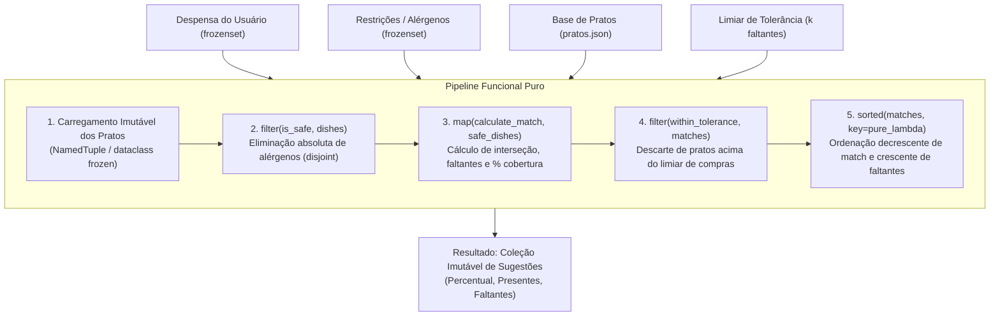
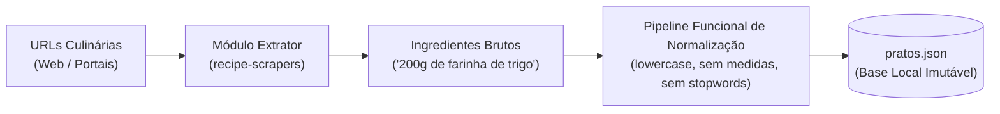
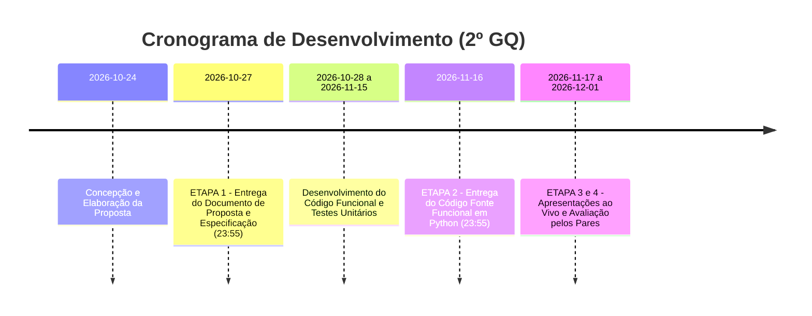

# 🍳 Cook What U Have (MealMatch)
### Motor Funcional de Indicação de Pratos e Redução do Desperdício Alimentar

> **Disciplina:** Programação Funcional em Python — Avaliação do 2º Grau de Qualificação (GQ)  
> **Etapa 1:** Especificação Detalhada da Situação-Problema e Proposta de Solução  
> **Prazo da Etapa 1:** 27/10/2026 às 23:55  
> **Prazo da Etapa 2 (Implementação):** 16/11/2026 às 23:55  

---

## 📌 Sumário Executivo

O **Cook What U Have** (também referenciado como **MealMatch**) é um sistema computacional concebido estritamente sob as premissas do **Paradigma de Programação Funcional (PF)** em Python. O seu objetivo central é solucionar a dissonância diária enfrentada por milhares de famílias: a coexistência entre o **desperdício de alimentos domésticos** e a **dificuldade de planeamento de refeições seguras** perante alergias e intolerâncias alimentares severas.

Diferente de plataformas convencionais que operam em fluxo imperativo de busca ("escolha um prato e compre os ingredientes faltantes"), o *Cook What U Have* **inverte radicalmente o fluxo**: processa a coleção de ingredientes disponíveis na despensa, aplica restrições alérgicas absolutas e projeta as opções de pratos viáveis por meio de teoria dos conjuntos, ordenadas pela maior taxa de cobertura e menor necessidade de compras adicionais.

---

## 1. Especificação Detalhada da Situação-Problema

### 1.1. O Paradoxo da Despensa Cheia e o Desperdício Alimentar
O desperdício de alimentos no ambiente doméstico é impulsionado principalmente pela incapacidade humana de correlacionar mentalmente ingredientes perecíveis dispersos em receitas viáveis. Frequentemente, os consumidores possuem diversos insumos (ex.: abobrinha, ovos, cebola, arroz cozido), mas acabam por recorrer a novos pedidos de entrega (*delivery*) ou a novas compras de supermercado por não vislumbrarem combinações imediatas. Os insumos prévios deterioram-se e são descartados, gerando prejuízos financeiros e impactos socioambientais significativos.

### 1.2. O Risco Crítico das Alergias e Restrições Alimentares
Segundo a Organização Mundial da Saúde (OMS), as alergias alimentares afetam uma parcela substancial da população global. Reações alérgicas a glúten (doença celíaca), lactose/proteína do leite, mariscos, nozes, amendoim e soja podem variar desde desconfortos gastrointestinais até choque anafilático potencialmente fatal.
* **A falha humana na inspeção manual:** A análise manual de listas extensas de receitas ou de cardápios é um processo demorado, cognitivamente exaustivo e altamente suscetível a erros humanos de desatenção.
* **A necessidade de rigor absoluto:** Um sistema confiável de recomendação culinária não pode tratar restrições alimentares como um mero critério ponderado de pontuação. A presença de um único alérgeno interdito deve desqualificar **terminantemente e determinísticamente** o prato do rol de sugestões.

### 1.3. Limitações das Plataformas Atuais
As plataformas de receitas existentes (como TudoGostoso, Tastemade e Allrecipes) sofrem de três gargalos conceituais:
1. **Busca Nominal Unidirecional:** O usuário é obrigado a saber antecipadamente o nome do prato que deseja confeccionar.
2. **Excesso de Instruções Não Essenciais:** Focam em gerar descrições textuais longas de passos de preparo, tempos de forno e vídeos, negligenciando a etapa primordial da tomada de decisão ("o que é matematicamente possível cozinhar agora?").
3. **Ausência de Transparência na Cobertura:** Raramente informam a porcentagem exata de insumos já presentes versus a lista minimalista do que realmente falta comprar.

### 1.4. Inversão do Fluxo Operacional
O *Cook What U Have* inverte este paradigma através de uma abordagem orientada a dados e álgebra de conjuntos:

```
[Fluxo Convencional - Problemático]
Ideia do Prato ──► Leitura de 20 Ingredientes ──► Ida ao Supermercado ──► Descarte do que sobrou na despensa

[Fluxo do Cook What U Have - Proposto]
Despensa Atual (O que tenho) ──► Filtro de Segurança (Alérgenos = 0) ──► Otimização de Cobertura ──► Prato Viável + Lista Residual Mínima
```

---

## 2. Proposta de Programa e Escopo da Solução

### 2.1. O que é o *Cook What U Have*
O programa atuará como um **motor determinístico de decisão, filtragem e recomendação culinária**. Não se propõe a ser um livro de receitas prolixo com tutoriais culinários, mas uma ferramenta computacional precisa que responde com exatidão matemática:
> *"Com os $N$ ingredientes presentes na sua despensa e banindo absolutamente os alérgenos $A$, quais são os pratos possíveis de serem feitos, qual a taxa de cobertura de cada um e o que exatamente resta comprar?"*

### 2.2. Delimitação de Fronteiras (Escopo)

| Dimensão | Em Escopo (In-Scope) | Fora de Escopo (Out-of-Scope) |
| :--- | :--- | :--- |
| **Lógica de Decisão** | Álgebra de conjuntos puros (interseção, diferença, pertinência) e ranking de cobertura. | Algoritmos de redes neurais opacos ou modelos estocásticos não determinísticos. |
| **Segurança Alimentar** | Exclusão determinística rígida com base em lista de termos interditos. | Diagnóstico médico de alergias ou análise química de traços microscópicos. |
| **Base de Dados** | Extração de fontes confiáveis via `recipe-scrapers` e persistência estática em `pratos.json`. | Banco de dados relacional (SQL) com transações mutáveis ou escrita concorrente em disco. |
| **Instruções Culinárias** | Metadados essenciais (identificador, nome, categoria e conjunto de ingredientes padronizados). | Textos descritivos de modo de preparo, tempo de forno, temperatura ou vídeos tutoriais. |
| **Interface** | CLI (Interface de Linha de Comando) interativa puramente declarativa com suporte a relatórios estruturados. | Frontend web complexo ou aplicativo mobile baseado em frameworks de estado reativo mutável. |

---

## 3. Aplicação Rigorosa do Paradigma de Programação Funcional

A totalidade da lógica de negócio do sistema será estruturada em conformidade estrita com os fundamentos de Programação Funcional (PF), garantindo corretude formal, testabilidade e ausência de bugs relacionados a estado compartilhado.



### 3.1. Imutabilidade Absoluta de Dados
* Nenhuma entidade de domínio permitirá alteração de estado após sua instanciação.
* Serão empregados exclusivamente `@dataclass(frozen=True)` e `NamedTuple` da biblioteca padrão do Python.
* Coleções de ingredientes e alérgenos serão instanciadas estritamente sob o tipo nativo `frozenset`.
* Proibição categórica de métodos mutadores como `.append()`, `.extend()`, `.pop()`, bem como de reatribuição de variáveis locais.

### 3.2. Funções Puras e Ausência de Efeitos Secundários (*Side Effects*)
* Todas as funções que realizam processamento, cálculo ou filtragem serão **funções puras** no sentido matemático: para os mesmos parâmetros de entrada, retornarão invariavelmente a mesma saída, sem consultar nem modificar variáveis globais.
* As operações de I/O (leitura do arquivo `pratos.json` e impressão no terminal) serão estritamente isoladas nas bordas externas da aplicação (*I/O Boundaries*), mantendo o núcleo da lógica computacional 100% puro.

### 3.3. Funções de Alta Ordem (*Higher-Order Functions*) e Composição
A manipulação e transformação de fluxos de dados prescindirá de laços imperativos, recorrendo ao encadeamento de funções de ordem superior:
* **`filter()`**: Utilizado para remover com garantia matemática qualquer prato cuja interseção com o conjunto de alérgenos seja não vazia (`ingredients.isdisjoint(allergens)`).
* **`map()`**: Utilizado para projetar os pratos seguros em estruturas enriquecidas de resultado (`MatchResult`), calculando a taxa percentual de cobertura e segregando insumos disponíveis e faltantes.
* **`sorted()`**: Recorrendo a funções `lambda` puras como critério de ordenação e relevância multicritério (ex.: maior taxa de match, menor quantidade de ingredientes faltantes).
* **`functools.partial`**: Utilizado para aplicação parcial e currying, parametrizando predicados de filtragem conforme as configurações do usuário.

### 3.4. Eliminação de Estruturas Imperativas
* Banimento completo do uso de laços `for` ou `while` que operem com acumuladores ou contadores mutáveis (`count += 1`, `lista.append(item)`).
* O processamento agregador ou redutor será implementado via funções de ordem superior (`functools.reduce`), compreensão declarativa de coleções imutáveis ou recursão de cauda onde apropriado.

### 3.5. Fundamentação na Teoria dos Conjuntos
As operações centrais do motor traduzem-se diretamente em operações primitivas sobre `frozenset`:
* **Pertinência de Alérgenos:** $\text{Seguro}(P, A) \iff (I_P \cap A) = \emptyset$ (ou `I_P.isdisjoint(A)`)
* **Ingredientes Presentes:** $I_{\text{presentes}} = I_P \cap D$
* **Ingredientes em Falta (Lista de Compras):** $I_{\text{faltantes}} = I_P \setminus D$
* **Taxa de Cobertura:** $\text{Score}(P, D) = \frac{|I_P \cap D|}{|I_P|} \times 100\%$

---

## 4. Modelagem de Dados Imutável

As estruturas de dados primárias serão expressas no módulo `models.py` da seguinte forma:

```python
from typing import NamedTuple
from dataclasses import dataclass

@dataclass(frozen=True)
class Dish:
    """Representa a entidade de um prato cadastrado na base imutável."""
    id: str
    name: str
    category: str
    ingredients: frozenset[str]

@dataclass(frozen=True)
class UserPreferences:
    """Encapsula a despensa, os alérgenos e parâmetros de tolerância do usuário."""
    pantry: frozenset[str]
    allergens: frozenset[str]
    max_missing_threshold: int = 0

@dataclass(frozen=True)
class MatchResult:
    """Resultado imutável da análise de viabilidade de um prato."""
    dish: Dish
    match_percentage: float
    available_ingredients: frozenset[str]
    missing_ingredients: frozenset[str]
```

---

## 5. Engenharia de Dados e Extração (`recipe-scrapers`)

Para garantir que a base de dados não seja trivial ou fictícia, será desenvolvido um módulo independente de extração e higienização de receitas baseado na biblioteca [`recipe-scrapers`](https://github.com/hhursev/recipe-scrapers).



### 5.1. Módulo de Normalização Funcional
As receitas extraídas da web contêm quantidades e formas de preparo anexadas aos nomes dos ingredientes (ex: *"2 xícaras de farinha de trigo peneirada"*). Um pipeline funcional de sanitização de strings aplicará sucessivas transformações puras:
1. Conversão para minúsculas (`str.lower`).
2. Remoção de pontuação, acentuação e medidas culinárias padronizadas (`xícara`, `colher`, `gramas`, `ml`, `kg`).
3. Limpeza de termos conectivos e adjetivos (*stopwords* culinárias: `de`, `em cubos`, `picado`, `peneirada`).
4. Extração do insumo canônico (`"farinha de trigo"`).

### 5.2. Especificação do Formato `pratos.json`
O resultado da extração prévia será persistido em um arquivo JSON estático que servirá de entrada *read-only* para o motor:

```json
[
  {
    "id": "dish_001",
    "name": "Omelete de Espinafre e Queijo",
    "category": "Prato Principal",
    "ingredients": ["ovo", "espinafre", "queijo", "manteiga", "sal"]
  },
  {
    "id": "dish_002",
    "name": "Moqueca de Camarão",
    "category": "Peixes e Frutos do Mar",
    "ingredients": ["camarao", "leite de coco", "azeite de dende", "pimentao", "cebola", "coentro", "tomate"]
  },
  {
    "id": "dish_003",
    "name": "Risoto de Abobrinha com Tomate Seco",
    "category": "Massas e Risotos",
    "ingredients": ["arroz arboreo", "abobrinha", "tomate seco", "cebola", "caldo de legumes", "azeite"]
  }
]
```

---

## 6. Especificação das Entradas e Saídas do Sistema

### 6.1. Entradas do Sistema
1. **Despensa do Usuário ($D$):** Coleção de strings representando os ingredientes existentes no domicílio.
   * *Exemplo:* `["ovo", "espinafre", "sal", "azeite", "arroz arboreo", "abobrinha"]`
2. **Restrições / Alérgenos ($A$):** Coleção de ingredientes ou termos alimentares que devem ser banidos.
   * *Exemplo:* `["camarao", "leite de coco", "frutos do mar"]`
3. **Limiar de Tolerância ($k$):** Inteiro não negativo (opcional, padrão $k=0$). Determina o número máximo tolerado de ingredientes faltantes para que um prato ainda seja exibido (permitindo planejar pequenas compras pontuais).

### 6.2. Saídas do Sistema
O sistema gera um relatório ordenado de sugestões contendo:
* **Nome do Prato e Categoria.**
* **Percentagem de Correspondência (% Match):** Taxa percentual de insumos do prato presentes na despensa.
* **Ingredientes Disponíveis:** Relação exata dos itens que o usuário já possui.
* **Ingredientes em Falta:** Relação sucinta dos insumos ausentes (caso $k > 0$), funcionando como lista de compras automatizada.

#### Exemplo Visual da Saída no Terminal:

```text
================================================================================
        🍳 COOK WHAT U HAVE — SUGESTÕES DE REFEIÇÃO DISPONÍVEIS
================================================================================
Filtros Ativos:
- Despensa: [arroz arboreo, abobrinha, espinafre, ovo, sal]
- Alérgenos Banidos: [camarao, frutos do mar, leite de coco]
- Limiar de Tolerância: Até 2 itens faltantes
--------------------------------------------------------------------------------

[1] OMELETE DE ESPINAFRE E QUEIJO (Categoria: Prato Principal)
    Correspondência: 60.0% [3/5 ingredientes]
    ✅ Disponíveis em casa: [espinafre, ovo, sal]
    🛒 Lista de compras (faltam 2): [manteiga, queijo]

[2] RISOTO DE ABOBRINHA COM TOMATE SECO (Categoria: Massas e Risotos)
    Correspondência: 33.3% [2/6 ingredientes]
    ✅ Disponíveis em casa: [abobrinha, arroz arboreo]
    🛒 Lista de compras (faltam 4): [azeite, caldo de legumes, cebola, tomate seco]
    (Oculto por exceder a tolerância de faltantes <= 2)

--------------------------------------------------------------------------------
🚫 Pratos desclassificados por segurança alimentar (Alérgenos detectados):
   - Moqueca de Camarão (Contém: 'camarao', 'leite de coco')
================================================================================
```

---

## 7. Estrutura Arquitetural do Código

O projeto adotará a seguinte organização modular, separando com clareza dados estáticos, lógica pura e adaptadores de I/O:

```
cook-what-u-have/
│
├── data/
│   └── pratos.json                 # Base de dados estática extraída
│
├── docs/
│   └── trabalhoProgramacaoFuncional.pdf  # Enunciado original do trabalho acadêmico
│
├── scraper/
│   ├── __init__.py
│   ├── extractor.py                # Extração via recipe-scrapers
│   └── normalizer.py               # Pipeline funcional de sanitização textual
│
├── src/
│   ├── __init__.py
│   ├── models.py                   # Entidades imutáveis (dataclass frozen)
│   ├── engine.py                   # Funções matemáticas puras (interseção, coberturas)
│   ├── pipeline.py                 # Funções de alta ordem (filter, map, sorted)
│   ├── io_adapter.py               # Leitura pura de JSON e formatação de saída CLI
│   └── main.py                     # Ponto de entrada (Entrypoint)
│
├── tests/
│   ├── __init__.py
│   ├── test_engine.py              # Testes unitários de determinismo e teoria dos conjuntos
│   ├── test_pipeline.py            # Testes de exclusão de alérgenos e ranking
│   └── test_immutability.py        # Testes de garantia de imutabilidade de dados
│
├── requirements.txt                # Dependências mínimas (recipe-scrapers, pytest)
└── README.md                       # Documento de proposta e especificação completa
```

---

## 8. Planejamento de Desenvolvimento e Cronograma de Entregas

Conforme as diretrizes estipuladas no documento acadêmico da disciplina, o projeto é subdividido em quatro etapas formais:



| Etapa | Data Limite | Descrição e Entregáveis | Penalidade / Observações |
| :---: | :---: | :--- | :--- |
| **Etapa 1** | **27/10/2026 (ter)**<br>até às 23:55 | **Entrega do Documento de Especificação Detalhada:** Especificação aprofundada da situação-problema, formalização matemática da solução funcional, escopo e modelagem. | Atrasos implicam na penalização de **1,0 ponto** na nota final. |
| **Etapa 2** | **16/11/2026 (ter)**<br>até às 23:55 | **Entrega do Código Fonte Completo:** Implementação em Python sob preceitos rigorosos do paradigma funcional, testes unitários automatizados cobrindo imutabilidade e pureza. | Atrasos implicam na penalização de **2,0 pontos** na nota final. |
| **Etapa 3** | **17/11, 24/11, 27/11 e 01/12/2026** | **Apresentação da Solução:** Demonstração ao vivo do programa em execução para a professora e para a turma, com explicação técnica do código desenvolvido e justificativa dos conceitos funcionais. | Cronograma das apresentações a ser disponibilizado no Teams. |
| **Etapa 4** | Durante as sessões de apresentação | **Avaliação pelos Pares:** Preenchimento de formulário impresso avaliando os trabalhos dos colegas com notas de 0 a 10 segundo critérios pré-estabelecidos. | Notas muito discrepantes das notas da professora serão penalizadas. |

### Composição da Nota Final do 2º GQ:
$$\text{Nota Final} = (0.7 \times \text{Trabalho}) + (0.1 \times \text{Lista de Exercícios}) + (0.1 \times \overline{\text{Notas dos Colegas}}) + (0.1 \times \text{Nota por Avaliar})$$

---

## 9. Critérios de Qualidade e Conformidade com o Paradigma Funcional

Para garantir nota máxima e atender a todos os requisitos de avaliação docente e pelos pares, o projeto passará por um rigoroso checklist de conformidade:

- [x] **Zero Mutações de Estado:** Sem variáveis reatribuídas; todas as estruturas são congeladas (`frozen=True`, `NamedTuple`, `frozenset`).
- [x] **Zero Loops Imperativos com Acumuladores:** Sem `for` ou `while` modificando listas ou contadores em memória.
- [x] **Isolamento de Efeitos Colaterais:** Código central 100% livre de operações de escrita ou leitura externa não determinística.
- [x] **Testes Automatizados de Pureza:** Suíte de testes com `pytest` verificando que invocar funções múltiplas vezes com os mesmos argumentos produz idênticos resultados sem alterar parâmetros recebidos.
- [x] **Segurança Alimentar com Tolerância Zero:** Garantia matemática de que nenhum alérgeno declarado figurará nas sugestões finais.

---

## 10. Como Executar o Projeto (Guia Inicial)

### Pré-requisitos
* Python 3.10 ou superior
* Gerenciador de pacotes `pip`

### Instalação de Dependências
```bash
pip install -r requirements.txt
```

### Execução dos Testes Automatizados
```bash
pytest tests/ -v
```

### Execução do Motor de Sugestões
```bash
python3 -m src.main
```
