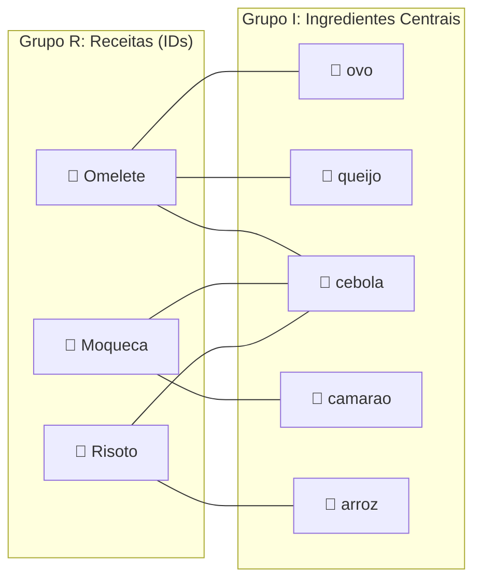

# ⚙️ Módulo de Implementação Funcional (`implementation/`)
### Grafo Bipartido, Álgebra de Conjuntos e Motor de Recomendação Puro

> **Componente do Projeto:** *Cook What U Have (MealMatch)*  
> **Responsabilidade:** Núcleo computacional do sistema, executando modelagem imutável, montagem do Grafo Bipartido ($R \leftrightarrow I$), poda determinística de alérgenos, cálculo de cobertura da despensa e ordenação multicritério.

---

## 🎯 1. Diretrizes de Engenharia e Rigor Funcional

O módulo `implementation/` segue os mais rigorosos padrões da Programação Funcional:

1. **Ausência de Instruções `def`:** Todas as operações lógicas foram concebidas e implementadas como **funções lambda de primeira ordem**, enfatizando a natureza de expressões matemáticas puras.
2. **Imutabilidade Total:** Todas as entidades são estruturadas via `NamedTuple` com coleções nativas `tuple` e `frozenset`. Zero métodos mutadores em memória.
3. **Isolamento de Efeitos Secundários (*Side-Effects*):** Este módulo é 100% puro e agnóstico a I/O. Nenhuma função interna acessa arquivos, rede ou console.
4. **Álgebra de Conjuntos Ótima:** Operações de pertinência, interseção ($\cap$) e diferença ($\setminus$) com complexidade $O(1)$ amortizada via hashing.

---

## 🌐 2. O Grafo Bipartido de Receitas e Ingredientes (`graph.py`)

A relação entre receitas e ingredientes forma um grafo bipartido imutável com adjacência bidirecional:



* **Adjacência Direta ($R \to I$):** Dado o ID de um prato, resgata em $O(1)$ o `frozenset` dos seus ingredientes.
* **Adjacência Invertida ($I \to R$):** Dado um ingrediente, resgata em $O(1)$ o `frozenset` de pratos que o contêm, permitindo podas e cruzamentos instantâneos.

---

## 📐 3. Estruturas de Dados Imutáveis (`models.py`)

```python
class Dish(NamedTuple):
    id: str
    name: str
    category: str
    recipe: tuple[str, ...]
    raw_ingredients: tuple[str, ...]
    clean_ingredients: frozenset[str]

class UserPreferences(NamedTuple):
    pantry: frozenset[str]
    allergens: frozenset[str]
    max_missing: int = 0
    category_filter: str | None = None

class MatchResult(NamedTuple):
    dish: Dish
    match_percentage: float
    available_ingredients: frozenset[str]
    missing_ingredients: frozenset[str]

class RecipeGraph(NamedTuple):
    recipe_to_ingredients: Mapping[str, frozenset[str]]
    ingredient_to_recipes: Mapping[str, frozenset[str]]
    dishes_by_id: Mapping[str, Dish]
```

---

## 🧮 4. Álgebra de Conjuntos e Funções Puras (`engine.py`)

* **Poda de Alérgenos no Grafo Invertido:**
  $$\text{Contaminados} = \bigcup_{a \in A} \text{Grafo}[a] \quad \implies \quad R_{\text{seguros}} = R_{\text{total}} \setminus \text{Contaminados}$$
* **Ingredientes Disponíveis:** $I_P \cap D$
* **Ingredientes Faltantes (Lista de Compras):** $I_P \setminus D$
* **Pontuação de Cobertura (%):** $\frac{|I_P \cap D|}{|I_P|} \times 100\%$

---

## 🔗 5. Pipeline Declarativo de Alta Ordem (`pipeline.py`)

A orquestração de recomendação é expressa através da composição pura:

$$\text{Grafo} \xrightarrow{\text{prune}} \text{Seguros} \xrightarrow{\text{filter (categoria)}} \text{Filtrados} \xrightarrow{\text{map (match)}} \text{Matches} \xrightarrow{\text{filter (tolerância)}} \text{Viáveis} \xrightarrow{\text{sorted}} \text{Resultado}$$

```python
run_recommendation = lambda graph, prefs: tuple(
    sorted(
        filter(
            lambda m: is_within_tolerance(m, prefs.max_missing),
            map(
                lambda d: calculate_match(d, prefs.pantry),
                filter(
                    lambda d: matches_category(d, prefs.category_filter),
                    map(
                        lambda did: graph.dishes_by_id[did],
                        prune_allergens(graph, prefs.allergens),
                    ),
                ),
            ),
        ),
        key=criterio_ordenacao,
    )
)
```

---

## 📂 6. Estrutura de Arquivos da Pasta

```
implementation/
├── models.py            # Entidades imutáveis em NamedTuple
├── graph.py             # Construtor puro do Grafo Bipartido R <-> I com lambdas
├── engine.py            # Funções matemáticas de conjuntos e poda de alérgenos
├── pipeline.py          # Pipeline de recomendação via composição funcional
├── loader.py            # Conversor puro de dicionários JSON para instâncias Dish
└── README.md            # Documentação técnica do núcleo funcional
```
