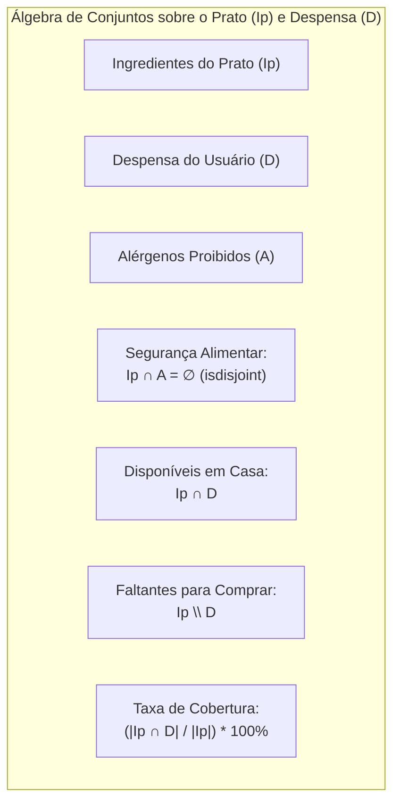

#  Módulo de Implementação Funcional (`implementation/`)
### Núcleo Computacional, Álgebra de Conjuntos e Pipeline Puro

> **Componente do Projeto:** *Cook What U Have*  
> **Responsabilidade:** Contém o coração algorítmico do sistema, executando filtragem por alérgenos, cálculo de cobertura de despensa e ordenação de viabilidade sob estrita conformidade com o **Paradigma de Programação Funcional (PF)** em Python.

---

## 1. Objetivo e Diretrizes de Engenharia

O módulo `implementation/` encapsula toda a regra de negócio do projeto. O seu código é projetado para satisfazer plenamente os critérios de avaliação acadêmica da disciplina de Programação Funcional:

1. **Zero Mutações de Estado:** Não existem variáveis mutáveis ou coleções dinâmicas modificadas in-place.
2. **Determinismo Absoluto:** Todas as funções comportam-se como funções matemáticas puras: dadas as mesmas entradas, a saída é categoricamente invariante.
3. **Isolamento de Efeitos Secundários (*Side Effects*):** Este módulo é agnóstico a operações de I/O. Nenhuma função interna lê do disco (`open`), consulta a internet ou imprime na saída padrão (`print`).
4. **Sem Estruturas Imperativas Tradicionais:** Banimento integral de laços `for` e `while` com acumuladores ou contadores mutáveis (`count += 1`, `lista.append(x)`).

---

##  2. Modelagem de Dados Imutável (`models.py`)

As entidades fundamentais do sistema são modeladas por meio de `@dataclass(frozen=True)` e tipos imutáveis nativos do Python:

```python
from dataclasses import dataclass

@dataclass(frozen=True)
class Dish:
    """Entidade imutável que representa um prato cadastrado."""
    id: str
    name: str
    category: str
    ingredients: frozenset[str]

@dataclass(frozen=True)
class UserPreferences:
    """Entrada imutável com preferências do usuário."""
    pantry: frozenset[str]
    allergens: frozenset[str]
    max_missing_threshold: int = 0

@dataclass(frozen=True)
class MatchResult:
    """Projeção analítica do resultado de correspondência de um prato."""
    dish: Dish
    match_percentage: float
    available_ingredients: frozenset[str]
    missing_ingredients: frozenset[str]
```

### Por que `frozenset`?
* **Imutabilidade Garantida:** Diferente do `set` convencional, o `frozenset` não possui métodos como `.add()`, `.remove()` ou `.pop()`. Uma vez instanciado, seu estado é congelado para sempre.
* **Complexidade Assintótica Ótima:** Operações de pertinência (`in`), interseção (`&`) e diferença (`-`) operam em tempo médio $O(1)$ ou $O(\min(N, M))$, conferindo alta performance determinística.

---

## 3. Álgebra de Conjuntos e Funções Puras (`engine.py`)

Toda a lógica de análise de pratos é deduzida diretamente a partir de operações primitivas da teoria dos conjuntos:



### Funções Puras Centrais:

```python
from functools import partial

def is_safe_dish(dish: Dish, allergens: frozenset[str]) -> bool:
    """
    Predicado puro: Verifica se o prato está livre de qualquer alérgeno.
    Retorna True se a interseção entre os ingredientes e os alérgenos for vazia.
    """
    return dish.ingredients.isdisjoint(allergens)

def calculate_match(dish: Dish, pantry: frozenset[str]) -> MatchResult: 
    """
    Função pura de projeção: Calcula os insumos presentes, faltantes e o percentual de cobertura.
    """
    available = dish.ingredients & pantry
    missing = dish.ingredients - pantry
    percentage = (len(available) / len(dish.ingredients)) * 100.0 if dish.ingredients else 0.0

    return MatchResult(
        dish=dish,
        match_percentage=round(percentage, 2),
        available_ingredients=available,
        missing_ingredients=missing
    )

def is_within_tolerance(match: MatchResult, max_missing: int) -> bool:
    """
    Predicado puro: Filtra pratos que respeitam o limiar de itens faltantes.
    """
    return len(match.missing_ingredients) <= max_missing
```

---

##  4. Pipeline Funcional e Funções de Alta Ordem (`pipeline.py`)

A orquestração do fluxo computacional é realizada via composição declarativa de funções de ordem superior (`filter`, `map`, `sorted`), eliminando a necessidade de laços mutáveis:

```python
from functools import partial

def run_meal_recommendation(
    dishes: tuple[Dish, ...],
    preferences: UserPreferences
) -> tuple[MatchResult, ...]:
    """
    Pipeline funcional completo de recomendação.
    Recebe coleções imutáveis e retorna uma tupla imutável ordenada.
    """
    # 1. Filtro puro: Eliminar pratos com alérgenos
    safe_dishes = filter(
        lambda dish: is_safe_dish(dish, preferences.allergens),
        dishes
    )

    # 2. Mapeamento puro: Calcular métricas de match
    matches = map(
        lambda dish: calculate_match(dish, preferences.pantry),
        safe_dishes
    )

    # 3. Filtro puro: Aplicar tolerância máxima de compras
    viable_matches = filter(
        lambda match: is_within_tolerance(match, preferences.max_missing_threshold),
        matches
    )

    # 4. Ordenação pura: Decrescente de cobertura (%) e crescente de faltantes
    sorted_matches = sorted(
        viable_matches,
        key=lambda m: (-m.match_percentage, len(m.missing_ingredients), m.dish.name)
    )

    return tuple(sorted_matches)
```

---

##  5. Estrutura de Arquivos da Pasta

```
implementation/
│
├── __init__.py
├── models.py            # Dataclasses imutáveis (Dish, UserPreferences, MatchResult)
├── engine.py            # Funções matemáticas puras e predicados sobre frozenset
├── pipeline.py          # Composição funcional e funções de alta ordem (filter, map, sorted)
└── README.md            # Documentação técnica do núcleo funcional
```

---

##  6. Estratégia de Testes Automatizados e Provas de Conformidade

O diretório `tests/` do projeto valida o rigor funcional deste módulo:

* **Teste de Imutabilidade:** Tentativas de reatribuir atributos em instâncias de `Dish` ou `MatchResult` disparam exceção `FrozenInstanceError` em tempo de execução.
* **Teste de Pureza e Idempotência:** Chamar `calculate_match` múltiplas vezes com os mesmos argumentos garante retornos idênticos sem mutação nas coleções recebidas.
* **Teste de Segurança de Alérgenos:** Casos de teste sintéticos com alérgenos críticos (ex.: glúten, frutos do mar) verificam que nenhum falso negativo escapa do predicado `is_safe_dish`.

