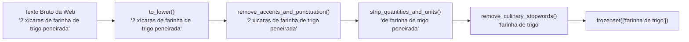

#  Módulo de Ingestão de Dados (`ingestion/`)
### Extração de Receitas, Normalização Funcional e Geração da Base Imutável

> **Componente do Projeto:** *Cook What U Have (MealMatch)*  
> **Responsabilidade:** Extrair receitas reais de fontes gastronômicas, sanitizar e padronizar textos via transformações puras e estruturar o catálogo estático imutável (`pratos.json`).

---

##  1. Objetivo e Papel na Arquitetura

O módulo de **Ingestão de Dados** atua como uma etapa prévia e desacoplada do motor central de recomendação. A sua existência isolada garante que:

1. **O Motor de Decisão permaneça 100% Offline e Determinístico:** Não há chamadas de rede HTTP, requisições instáveis ou dependência de conectividade durante a execução do algoritmo principal.
2. **Separação de Preocupações (*Separation of Concerns*):** O motor algorítmico da pasta `implementation/` trabalha exclusivamente com estruturas puras em memória (`Dish`, `frozenset`), sem se preocupar com as inconsistências de dados textuais da web.
3. **Imutabilidade do Repositório de Dados:** O artefato gerado (`data/pratos.json`) funciona como uma base estática e somente-leitura (*read-only*).

---

##  2. Tecnologias Utilizadas

* **[`recipe-scrapers`](https://github.com/hhursev/recipe-scrapers):** Biblioteca Python especializada em extrair metadados padronizados (título, categoria, porções e ingredientes) a partir de dezenas de portais gastronômicos que implementam o padrão semântico `Schema.org/Recipe`.
* **Expressões Regulares Declarativas (`re`):** Padrões compilados para remoção precisa de numerais, frações (ex.: ½, ¼) e unidades métricas.
* **Paradigma Funcional:** Todas as operações de limpeza e enriquecimento de strings são expressas através de **funções puras** e encadeadas.

---

## 3. Pipeline Funcional de Sanitização e Normalização

### 3.1. O Problema dos Dados Brutos
Em websites culinários, os ingredientes aparecem descritos de forma livre e ruidosa, misturando quantidades, recipientes, marcas e técnicas de corte:
* *"2 colheres (sopa) de manteiga sem sal em ponto de pomada"*
* *"300g de filé de camarão limpo e congelado"*
* *"1 pitada generosa de sal refinado a gosto"*

Para o motor funcional poder calcular interseções exatas de conjuntos ($\cap$), estes termos precisam ser reduzidos aos seus **ingredientes canônicos**:
$$\text{"manteiga"}, \quad \text{"camarao"}, \quad \text{"sal"}$$

### 3.2. Transformações Puras Encadeadas
O módulo de normalização aplica uma sequência determinística de funções sem mutação de estado:



#### Exemplo Teórico da Composição Funcional:
```python
from functools import reduce
from typing import Callable

# Pipeline de transformadores puros: String -> String
Pipeline = list[Callable[[str], str]]

def normalize_ingredient(raw_text: str, transformers: Pipeline) -> str:
    """Aplica sucessivamente transformadores puros sobre a string."""
    return reduce(lambda text, func: func(text), transformers, raw_text).strip()
```

---

##  4. Estrutura de Arquivos da Pasta

```
ingestion/
│
├── __init__.py
├── extractor.py         # Funções que recebem URLs e invocam recipe-scrapers
├── normalizer.py        # Funções puras de sanitização, remoção de unidades e stopwords
├── pipeline.py          # Orquestrador funcional: URLs -> Extração -> Limpeza -> JSON
├── sources.json         # Relação estática de URLs culinárias confiáveis
└── README.md            # Documentação técnica do módulo de ingestão
```

---

##  5. Esquema do Artefato Gerado (`pratos.json`)

O pipeline gera e persiste o catálogo no diretório `data/pratos.json`, formatado para leitura imutável:

```json
[
  {
    "id": "dish_001",
    "name": "Omelete de Espinafre e Queijo",
    "category": "Prato Principal",
    "ingredients": [
      "espinafre",
      "manteiga",
      "ovo",
      "queijo",
      "sal"
    ]
  },
  {
    "id": "dish_002",
    "name": "Moqueca Baiana Tradicional",
    "category": "Frutos do Mar",
    "ingredients": [
      "azeite de dende",
      "camarao",
      "cebola",
      "coentro",
      "leite de coco",
      "pimentao",
      "tomate"
    ]
  }
]
```

> **Nota sobre Padronização:**  
> Os ingredientes são persistidos ordenados alfabeticamente e já em sua forma canônica simplificada, facilitando o carregamento direto em coleções `frozenset` na camada de `implementation/`.

---

##  6. Como Executar o Módulo de Ingestão

Para disparar o processo de scraping e atualizar a base local `pratos.json`:

```bash
# A partir do diretório raiz do projeto:
python3 -m ingestion.pipeline
```

As dependências necessárias para a ingestão estão especificadas no `requirements.txt`:
```bash
pip install recipe-scrapers requests
```

