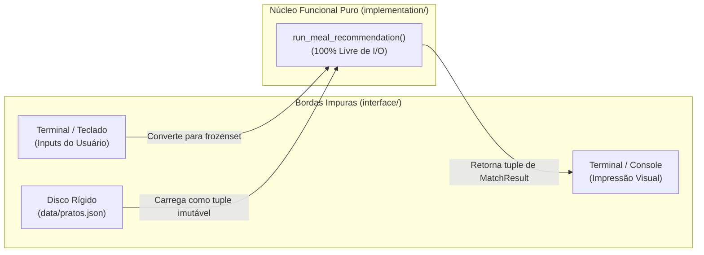

#  Módulo de Interface do Usuário e Adaptadores de I/O (`interface/`)
### Camada de Interação, Fronteiras de Efeitos Colaterais e Formatação Declarativa

> **Componente do Projeto:** *Cook What U Have (MealMatch)*  
> **Responsabilidade:** Gerenciar a interação com o usuário (CLI), carregar a base de dados imutável a partir do disco e formatar relatórios visuais claros, isolando os efeitos colaterais (*I/O Boundaries*) do núcleo funcional do sistema.

---

##  1. Objetivo e O Princípio Funcional de Bordas de I/O (*I/O Boundaries*)

Na arquitetura de sistemas funcionais, o código do domínio algorítmico deve ser mantido estritamente puro. No entanto, o mundo exterior é inerentemente impuro: o usuário digita entradas no teclado, arquivos no disco precisam ser lidos e caracteres coloridos precisam ser impressos no monitor.

O módulo `interface/` desempenha o papel de **casca protetora (*Functional Core, Imperative Shell*)**:
1. **Coleta e Conversão Impura:** Capta strings do usuário e converte-as imediatamente para coleções imutáveis `frozenset`.
2. **Carregamento Controlado:** Lê o arquivo estático `data/pratos.json` e o converte para uma tupla imutável `tuple[Dish, ...]`.
3. **Invocação do Core Puro:** Delega os dados para a função pura `run_meal_recommendation()` do módulo `implementation/`.
4. **Formatação Declarativa e Apresentação:** Recebe a tupla imutável de resultados (`MatchResult`), formata relatórios de forma determinística e imprime na saída padrão.



---

## 2. Funcionalidades da Interface

### 2.1. Modos de Operação
* **Modo Interativo (Prompt Amigável):** Solicita ao usuário os ingredientes disponíveis na despensa, os alérgenos ou restrições a excluir e o limiar de tolerância de compras faltantes.
* **Modo Argumentos de Linha de Comando (CLI com Flags):**
  ```bash
  python3 -m src.main --pantry "ovo, queijo, tomate" --allergens "gluten, camarao" --max-missing 1
  ```

### 2.2. Separação Estrita de Formatação
Para garantir que a formatação visual também seja testável e pura, o módulo decompõe a apresentação em:
* `formatter.py`: Funções **puras** que recebem um `MatchResult` e retornam uma `str` devidamente tabulada e colorida.
* `cli.py`: Único local que efetivamente executa o efeito colateral `print()`.

---

## 3. Estrutura de Arquivos da Pasta

```
interface/
│
├── __init__.py
├── cli.py               # Entrada principal da CLI, parsing de argumentos e exibição
├── formatter.py         # Funções puras de transformação: MatchResult -> String formatada
├── io_adapter.py        # Leitura controlada do arquivo data/pratos.json -> tuple[Dish, ...]
└── README.md            # Documentação técnica da camada de interface
```

---

## 4. Exemplo Visual da Saída Gerada pela Interface

Ao ser executada, a interface gera um relatório visualmente intuitivo, destacando ingredientes em posse do usuário, a lista de compras automatizada e os pratos barrados por segurança:

```text
================================================================================
        COOK WHAT U HAVE — SUGESTÕES DE REFEIÇÃO DISPONÍVEIS
================================================================================
Configurações da Sessão:
  • Ingredientes na Despensa (5): [abobrinha, azeite, cebola, ovo, sal]
  • Restrições Severas Banidas (2): [camarao, gluten]
  • Tolerância Máxima de Faltantes: Até 2 itens adicionais
--------------------------------------------------------------------------------

[1] OMELETE DE ABOBRINHA E CEBOLA (Categoria: Prato Principal)
    Correspondência: 100.0% [4/4 ingredientes]
     Todos os ingredientes disponíveis em casa! Pronto para cozinhar.

[2] RISOTO SIMPLES DE ABOBRINHA (Categoria: Massas e Risotos)
    Correspondência: 66.7% [4/6 ingredientes]
     Disponíveis em casa: [abobrinha, azeite, cebola, sal]
     Lista de compras (faltam 2 itens):
       • arroz arboreo
       • caldo de legumes

--------------------------------------------------------------------------------
 Pratos Bloqueados por Segurança Alimentar:
   - Macarronada ao Alho e Óleo (Bloqueado por conter: 'gluten')
   - Bobó de Camarão (Bloqueado por conter: 'camarao')
================================================================================
```

---

##  5. Testabilidade da Camada de Interface

A arquitetura com adaptadores desacoplados viabiliza testes unitários sem a necessidade de simular arquivos em disco:
* **Testes de Parsing (`io_adapter.py`):** Validação de que JSONs válidos geram instâncias congeladas de `Dish`, e JSONs com formato inválido lançam exceções tratadas de forma controlada.
* **Testes de Renderização (`formatter.py`):** Como as funções de formatação são puras, elas podem ser asseridas diretamente (`assert format_match(m) == expected_string`) sem necessidade de capturar saídas do stdout com `capsys`.

